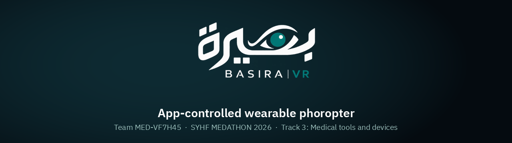
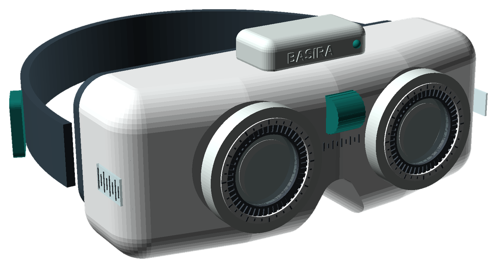
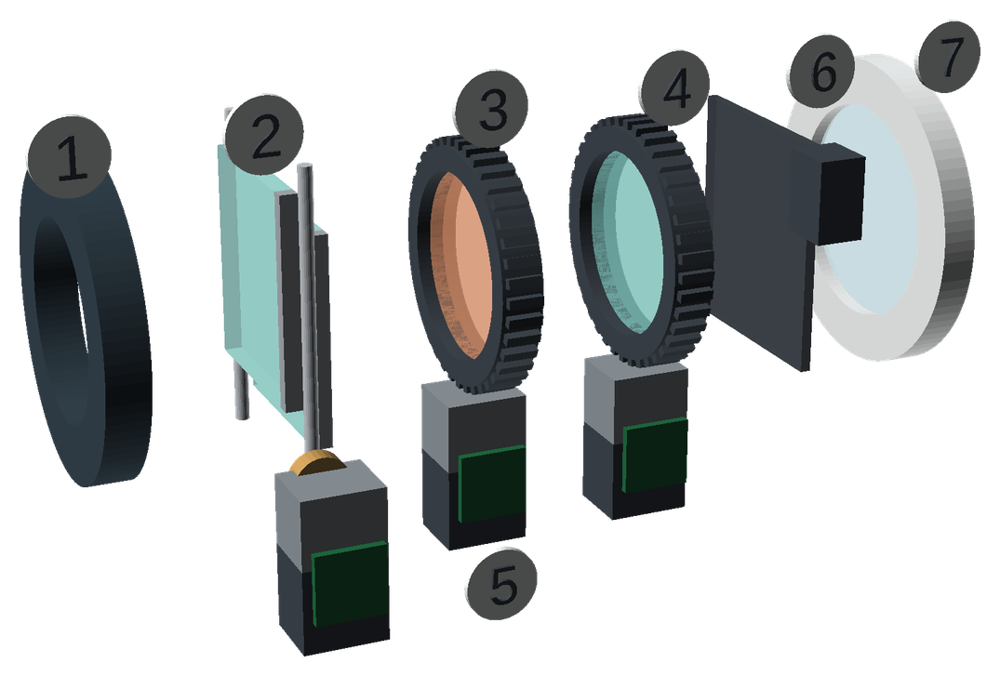
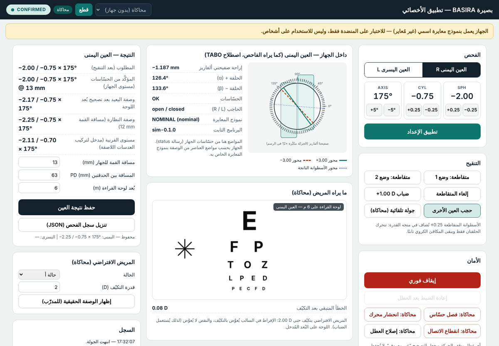
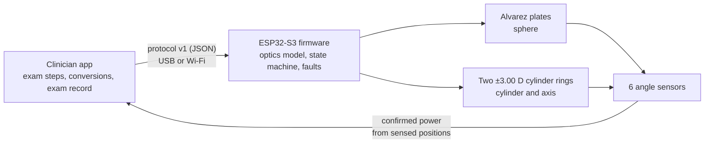

<p align="center"></p>

**BASIRA** (بصيرة) is a lightweight, 3D-printable headset that replaces the desk-mounted phoropter for eye refraction. The optometrist runs the whole exam from a tablet. Motors set solid lenses inside the headset, angle sensors confirm every setting, and the app returns the spectacle prescription and the corneal-plane value for contact-lens fitting.

| Stage | Question | Status |
|---|---|---|
| **Proof of concept** | Can the optics produce any prescription? | **Done by calculation:** exact over 38,194 prescriptions. Physical test (G1–G2) is next. |
| **Prototype** | Does the whole system work, and fail safely? | **Done digitally:** app + simulator + ESP32 firmware, 11 automated test suites. Physical (G3–G5) needs the parts. |
| **MVP** | Do optometrists use it on patients? | Planned: calibration, bench verification, ethics approval, then an agreement study. |

<p align="center">
&nbsp;&nbsp;
</p>
<p align="center"></p>

## Try it (30 seconds, no hardware)

Download [`dist/BASIRA_app.html`](dist/BASIRA_app.html) and open it in any browser; it is one self-contained file. Then choose **محاكاة** (simulation) → **اتصال** (connect) → **جولة تلقائية** (guided demo).

The demo runs a right-eye exam on a hidden simulated patient: sphere, cylinder, cross-cylinder flips and the max-plus endpoint. It ends at the patient's true prescription, −2.25 / −0.75 × 175.

## How it works



- **Sphere:** two Alvarez plates slide in opposite directions; power is linear in shift (2.00 D/mm).
- **Cylinder:** two counter-rotating ±3.00 D lenses (a Stokes pair). Their angle difference sets the power, their mean angle the axis.
- **Safety:** a value is reported only from the **sensed** positions, after verification. Any fault (sensor, stall, link, drift) stops all motion and marks the correction unknown.

## Repository

| Path | Contents |
|---|---|
| [`app/`](app) | Clinician app. Works with the simulator, or with the device over USB (Web Serial) or Wi-Fi. |
| [`firmware/`](firmware) | ESP32-S3 firmware (motors, sensors, state machine, calibration) and a host test bench |
| [`physics/`](physics) | Reference optics model and optical design checks |
| [`calibration/`](calibration) | Lensmeter capture, model fit, held-out acceptance check |
| [`validation/`](validation) | Clinical agreement (Bland–Altman), repeatability, usability (SUS) |
| [`tests/`](tests) | Golden vectors shared by Python, C++ and JavaScript; app and browser tests |
| [`cad/`](cad) | OpenSCAD: printable lensmeter fixture, headset concept |
| [`docs/`](docs) | [Architecture](docs/ARCHITECTURE.md) · [Protocol](docs/PROTOCOL.md) · [Wiring](docs/WIRING.md) · [Calibration](docs/CALIBRATION.md) · [V&V plan](docs/VERIFICATION_AND_VALIDATION.md) · [Iterations](docs/ITERATIONS.md) · [Blueprint](docs/BASIRA_final_blueprint_rev9.md) |
| [`submission/`](submission) | MEDATHON 2026 materials: pitch deck, demo video, six views, purchase list, usability test kit |

## Verification

```
pip install -r requirements.txt
./run_tests.sh        # 11 suites
```

- **Optics:** one reference model in Python. The C++ and JS ports reproduce its golden vectors to about 1e-14 D.
- **Firmware logic:** 231 checks against simulated drives, including every fault path.
- **Build:** the firmware compiles for the ESP32-S3 (74 % flash). It has not yet been run on a board.
- **App:** a full exam runs end to end in a headless browser.
- **Calibration fit:** recovers known parameters, and rejects a planted 0.25 D error.
- **Pending hardware:** see [`docs/VERIFICATION_AND_VALIDATION.md`](docs/VERIFICATION_AND_VALIDATION.md).

## Team

| | Role |
|---|---|
| **Asmaa Al-Sibaee** | Project and clinical lead · Doctor of Optometry, University of Jeddah |
| **Muna Bayazeed** | Data analysis and validation · Mathematics, University of Jeddah |
| **Mohammad Hussein** | Optical systems and software · KAUST |

Synthetic example data in `calibration/examples` and `validation/examples` exists only to test the code. Nothing here has been used on people.

© 2026 the BASIRA team. All rights reserved.
