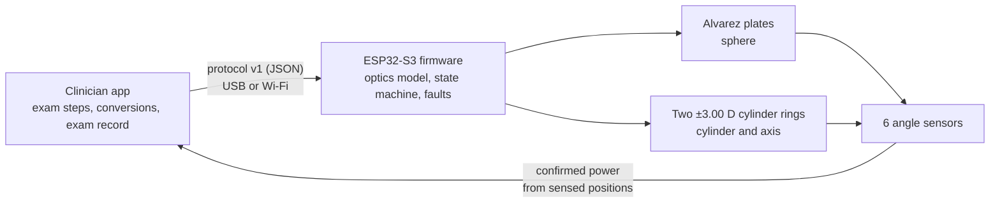

<p align="center"></p>

**BASIRA** (بصيرة) is a digital prototype of an app-controlled wearable phoropter for subjective refraction. The proposed headset uses motorized Alvarez plates and cylinder lenses with angle-sensor feedback. The simulator demonstrates the optometrist's exam workflow and computes spectacle- and corneal-plane values for a virtual patient.

| Stage | Question | Status |
|---|---|---|
| **Optics model** | Can the model reproduce power vectors in the design range? | Tested numerically over 38,194 nominal prescriptions. Lensmeter measurements of the Stokes pair and Alvarez plates (G1–G2) are pending. |
| **Digital prototype** | Can the app and firmware logic execute the exam and handle faults? | App, simulator and host-tested firmware core. Drive, interlock and headset verification on hardware (G3–G5) are pending. |
| **Human evaluation** | Can optometrists complete the workflow, and how does refraction agree with a reference? | Simulator usability kit ready. Participant sessions, physical calibration and a clinical agreement study are pending. |

<p align="center">
&nbsp;&nbsp;
</p>
<p align="center"></p>

## Try it (30 seconds, no hardware)

Download [`dist/BASIRA_app.html`](dist/BASIRA_app.html) and open it in any browser; it is one self-contained file. Then choose **محاكاة** (simulation) → **اتصال** (connect) → **جولة تلقائية** (guided demo).

The demo runs a right-eye exam on a hidden simulated patient: sphere, cylinder, cross-cylinder flips and the max-plus endpoint. It ends at the patient's true prescription, −2.25 / −0.75 × 175.

## How it works



- **Sphere:** two Alvarez plates slide in opposite directions; power is linear in shift (2.00 D/mm).
- **Cylinder:** two counter-rotating ±3.00 D lenses (a Stokes pair). Their angle difference sets the power, their mean angle the axis.
- **Firmware fault handling:** the controller reports optical power computed from sensed positions after settling. A fault commands the lens drives to brake, clears both confirmations and blocks jog and occluder commands until reset. The interlock is tested on simulated drives. Its response on physical hardware is pending.

## Repository

| Path | Contents |
|---|---|
| [`app/`](app) | Clinician app. Works with the simulator, or with the device over USB (Web Serial) or Wi-Fi. |
| [`firmware/`](firmware) | ESP32-S3 firmware (motors, sensors, state machine, calibration) and a host test bench |
| [`physics/`](physics) | Reference optics model and optical design checks |
| [`calibration/`](calibration) | Lensmeter capture, model fit, held-out acceptance check |
| [`validation/`](validation) | Clinical agreement (Bland–Altman), repeatability, usability (SUS) |
| [`tests/`](tests) | Golden vectors shared by Python, C++ and JavaScript; app and browser tests |
| [`cad/`](cad) | OpenSCAD: printable lensmeter fixture, headset concept |
| [`docs/`](docs) | [Architecture](docs/ARCHITECTURE.md) · [Protocol](docs/PROTOCOL.md) · [Wiring](docs/WIRING.md) · [Calibration](docs/CALIBRATION.md) · [V&V plan](docs/VERIFICATION_AND_VALIDATION.md) · [Iterations](docs/ITERATIONS.md) · [Blueprint](docs/BASIRA_final_blueprint_rev9.md) |
| [`submission/`](submission) | MEDATHON 2026 materials: pitch deck, demo video, six views, purchase list, usability test kit |

## Verification

```
pip install -r requirements.txt
bash run_tests.sh
```

- **Optics:** one reference model in Python. The C++ and JS ports reproduce its golden vectors to about 1e-14 D.
- **Firmware logic:** host tests use simulated drives and include STOP, sensor, stall, link, drift and driver faults.
- **ESP32-S3:** a previous build used 74 % flash with Arduino core 3.0.7. Run the optional target build to check the current revision. On-board testing is pending.
- **App:** the browser test exercises the simulated exam, prescription export and fault reset.
- **Calibration:** synthetic self-tests cover encoder wrap, model recovery, a planted 0.25 D sphere error and combined cylinder error. Both bundled noisy holdouts fail the current acceptance criteria.
- **Pending hardware:** see [`docs/VERIFICATION_AND_VALIDATION.md`](docs/VERIFICATION_AND_VALIDATION.md).

## Team

| | Role |
|---|---|
| **Asmaa Al-Sibaee** | Project and clinical lead · Doctor of Optometry, University of Jeddah |
| **Muna Bayazeed** | Data analysis and validation · Mathematics, University of Jeddah |
| **Mohammad Hussein** | Optical systems and software · KAUST |

Synthetic example data in `calibration/examples` and `validation/examples` exists only to test the code. Nothing here has been used on people.

© 2026 the BASIRA team. All rights reserved.
